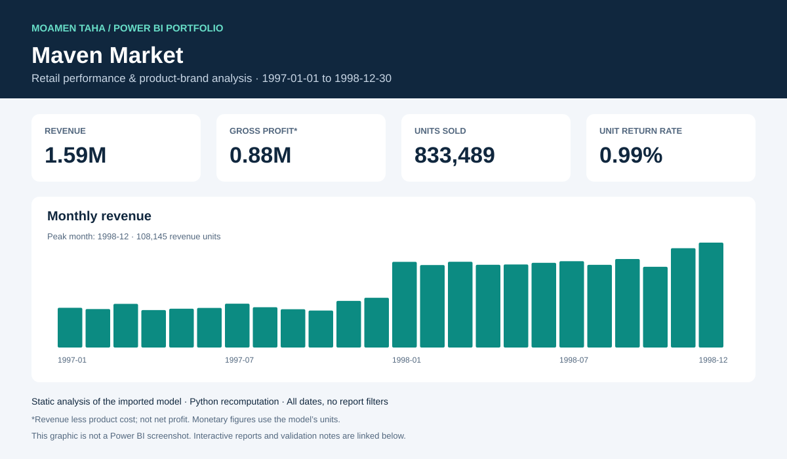

# Maven Market | Power BI Analytics

Retail performance & product-brand analysis. A portfolio project by **Moamen Taha Abuzied**.

[Download report](./maven%20market.pbix) · [Model & DAX](docs/MODEL.md) · [Quality review](docs/QUALITY_REVIEW.md) · [Desktop finishing steps](docs/DESKTOP_FINISH.md)



## Business focus

Track retail revenue, product costs, return quantities and brand performance across time and locations.

## Report tour

- **Retail overview** — prior-month KPI comparisons, weekly revenue, brand performance, geography and date/country filters.

## Data snapshot

| Metric | All imported data |
| --- | ---: |
| Dates | 1997-01-01–1998-12-30 |
| Fact rows | 269,720 |
| Units sold | 833,489 |
| Revenue | 1,588,091.80 |
| Product cost | 711,727.66 |
| Gross profit (revenue − product cost) | 876,364.14 |
| Gross margin | 55.18% |
| Returned units / sold units | 0.99% |

Order definition: 269,720 transaction rows; a distinct order ID is not present in the fact table.

These numbers were independently recomputed from the embedded tables using Python. They are **not DAX-engine results** and do not reproduce saved report filters. Amounts use the model's monetary units; profit here excludes operating expenses. [Evidence and source-file hash](docs/audit-results.json).

## Open and explore

1. Open the [PBIX file](./maven%20market.pbix) and choose **Download raw file** on GitHub.
2. Open it in Power BI Desktop and explore the pages and slicers.
3. To refresh, obtain the original source files and update the local source paths. Those source files are not distributed here.

## Technical work

- Power BI report design and interactive filtering.
- DAX measures for revenue, product cost, profit, returns and prior-month comparisons.
- Product-level revenue uses the model’s Discount_Price field; the revenue target is 105% of prior-month revenue.
- A reproducible Python audit of key coverage, calendar continuity and aggregate arithmetic.

## Validation and improvements

The current PBIX is preserved. The repository includes a [specific quality review](docs/QUALITY_REVIEW.md), [proposed measure fixes](improvements/measure-fixes.dax), a [report theme](improvements/portfolio-theme.json), and a PBIR polishing script. **These model/report fixes still require application and verification in Power BI Desktop.**

Reproduce the audit locally:

```bash
python -m pip install -r requirements.txt
python tools/audit_model.py "maven market.pbix" --output audit-results.json
```

## More work

[AdventureWorks sales analysis](https://github.com/moamenabden7-max/AdventureWorks-Sales-PowerBI) · [LinkedIn](https://www.linkedin.com/in/moamen-taha-data-analyst/)
